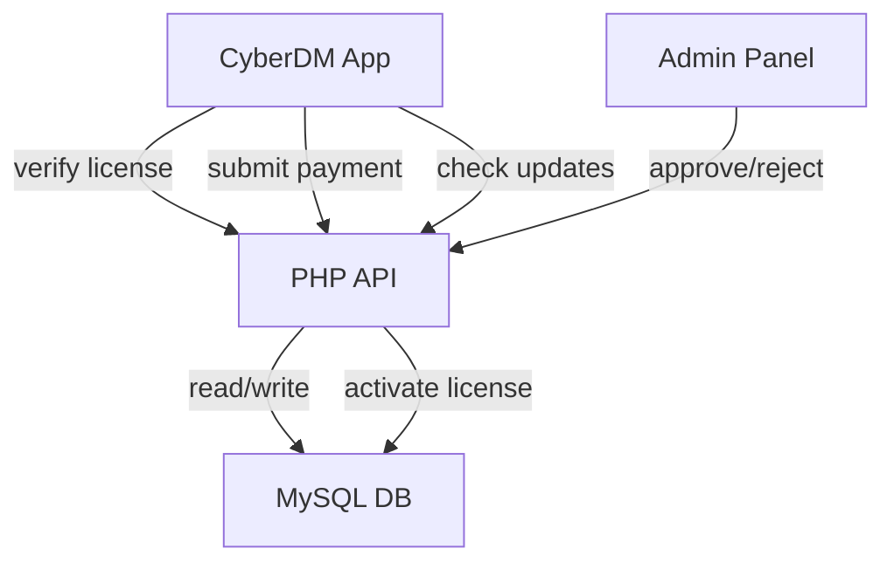

# CyberDM License + Payment + Update System — Implementation Plan

Complete monetization system with manual payment approval.

## Architecture Overview



---

## BASE API Config

Primary API: `https://surveymentor.org/CDM/api/`

Use `config.json` (DO NOT hardcode domain):
```json
{
  "api_primary": "https://surveymentor.org/CDM/api/",
  "api_backup": "https://sourov.pro.bd/api/"
}
```

Implement failover: Try primary → if fails → switch to backup.

---

## 1. Backend PHP API (Server-side)

### Database Schema (`db.sql`)

**licenses table:**
| Column | Type | Description |
|--------|------|-------------|
| id | INT AUTO_INCREMENT | Primary key |
| license_key | VARCHAR(64) | Unique license key |
| hwid | VARCHAR(128) | Device fingerprint (1 per license) |
| plan | ENUM('free','pro') | User plan |
| status | ENUM('active','expired','banned') | License state |
| expiry_date | DATETIME | Pro expiry date |
| created_at | DATETIME | Creation timestamp |

**payments table:**
| Column | Type | Description |
|--------|------|-------------|
| id | INT AUTO_INCREMENT | Primary key |
| license_key | VARCHAR(64) | Associated license |
| method | ENUM('ltc','bkash','nagad','rocket') | Payment method |
| trx_id | VARCHAR(128) | Transaction ID |
| screenshot_path | VARCHAR(255) | Uploaded screenshot |
| amount | DECIMAL(10,2) | Payment amount |
| status | ENUM('pending','approved','rejected') | Approval state |
| created_at | DATETIME | Submission timestamp |

### API Endpoints

| Endpoint | Method | Input | Output |
|----------|--------|-------|--------|
| `/activate.php` | POST | license_key, hwid | status, expiry_date, plan |
| `/verify.php` | POST | license_key, hwid | valid/invalid, plan, days_remaining |
| `/submit_payment.php` | POST | method, trx_id, screenshot, amount | license_key, message |
| `/admin_approve.php` | POST | payment_id, admin_key | success/fail |
| `/admin_reject.php` | POST | payment_id, admin_key | success/fail |
| `/version.php` | GET | — | latest_version, min_supported, force_update |

---

## 2. Admin Panel (Web Dashboard)

- Simple password-protected HTML panel
- View pending payments (method, trx_id, screenshot preview, amount)
- **Approve** button → activates license for 30 days
- **Reject** button → updates payment status

---

## 3. CyberDM Client Integration

### License Manager (`main.js`)
- `getHWID()` — Generate unique device fingerprint (CPU + MAC + hostname)
- `verifyLicense()` — Call API with failover (primary → backup)
- `applyRestrictions()` — Soft limits for free/expired users
- `checkForUpdates()` — Version check on startup
- Background verify every 24-48 hours
- Offline grace period: 2-3 days

### Soft Restrictions (Free/Expired vs Pro)

| Feature | Pro | Free/Expired |
|---------|-----|--------------|
| Download Speed | 100% | 50% cap |
| Max Threads | Unlimited | 4 max |
| Download Delay | None | 2s delay |
| YouTube Quality | All | Up to 720p |
| All Features | ✅ | ✅ (just slower) |

> **NOT a hard block** — app still works, just slower. Encourages upgrades.

### Upgrade to Pro Page UI
- Price: **$0.10/month** (LTC) / **10 TK/month** (bKash/Nagad/Rocket)
- LTC Address: `LKbYGyKFQsMtxP4ezZky5Q2DPMbGxqKKyp`
- bKash/Nagad/Rocket: `01687836626`
- Payment submission form: method, trx_id, screenshot upload, amount
- Submit → admin reviews → approve → license activated 30 days

---

## 4. Update System

API Response from `/version.php`:
```json
{
  "latest_version": "1.1.0",
  "min_supported": "1.0.0",
  "force_update": false,
  "download_url": "https://..."
}
```

App Logic:
- If `version < min_supported` → **block app** (force update)
- If `version < latest_version` → **show update popup** (optional)
- Gradual control: Normal → optional → force update later

---

## Payment Methods

### International
- **Litecoin (LTC)**: `LKbYGyKFQsMtxP4ezZky5Q2DPMbGxqKKyp`
- Price: **$0.10/month**

### Bangladesh Mobile Banking
- **bKash / Nagad / Rocket**: `01687836626`
- Price: **10 TK/month**

### User Flow
1. User clicks "Upgrade to Pro"
2. Chooses payment method
3. Sends payment manually
4. Submits form (method, trx_id, screenshot, amount)
5. Admin reviews → approves/rejects
6. On approval → license activated for 30 days with HWID binding

---

## Files to Create

| Type | Files | Location |
|------|-------|----------|
| Backend API | 6 PHP files + SQL | `api/` → deploy to server |
| Admin Panel | HTML + PHP | `api/admin/` → deploy to server |
| Client Config | `config.json` | `src/` |
| Client Code | Modified JS/CSS | `src/` |

---

## Security Notes
- Encrypted token system for license verification
- Basic validation + rate limiting on API
- HWID hashing (not raw)
- Admin key for approve/reject endpoints
- HTTPS only

---

**Developer**: Cyber Prince  
**Status**: Pending Implementation  
**Last Updated**: 2026-03-19
